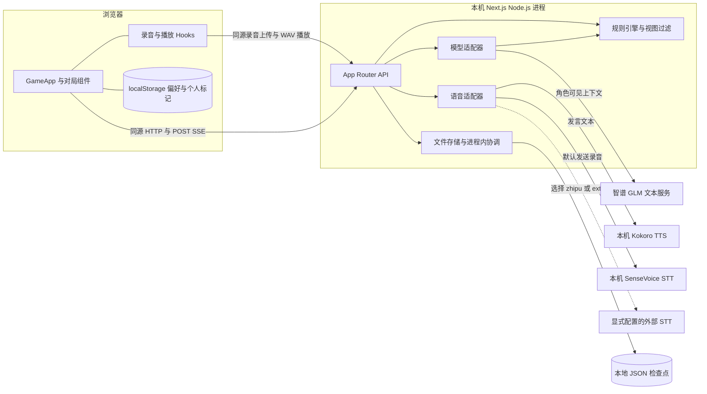
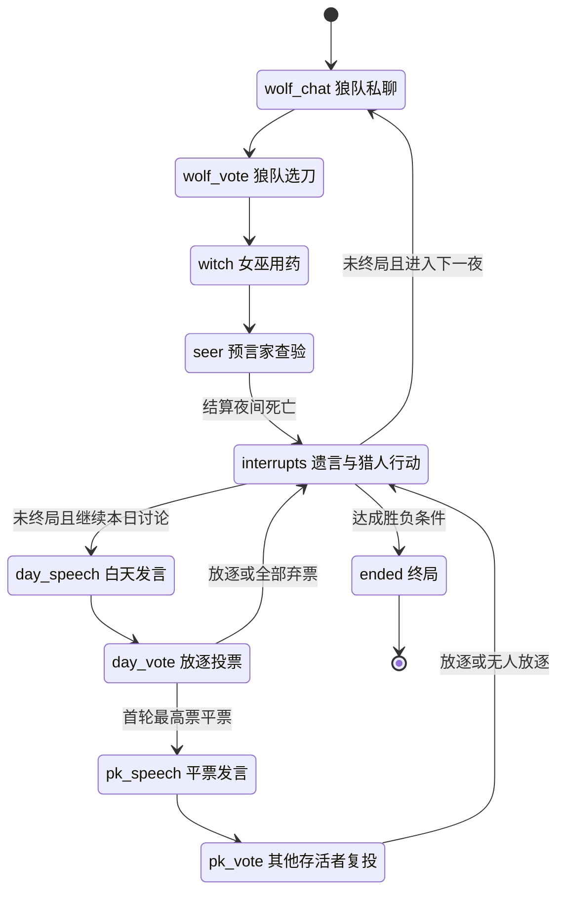
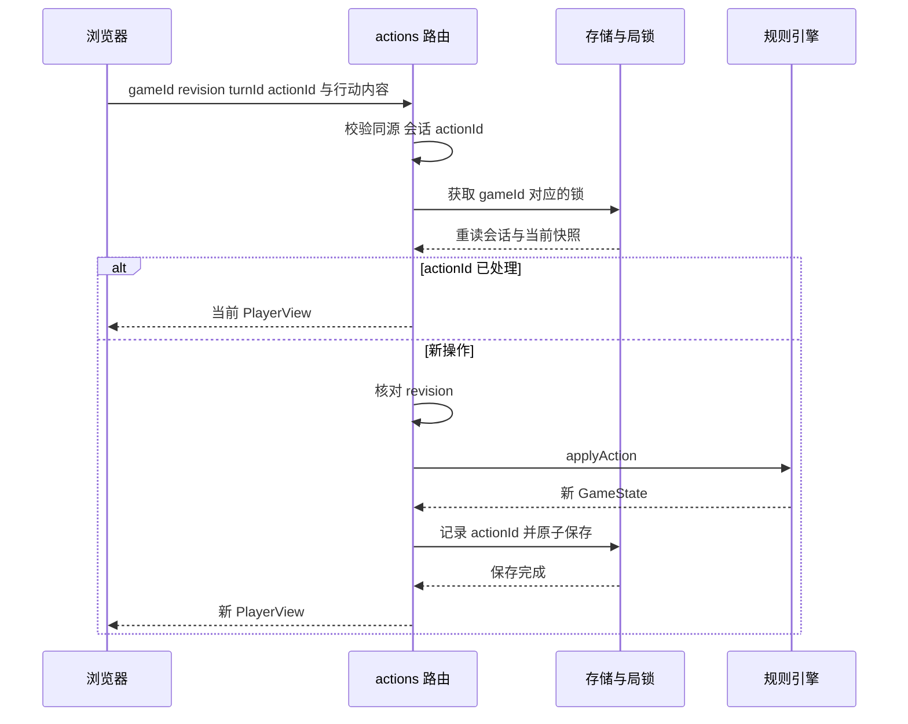
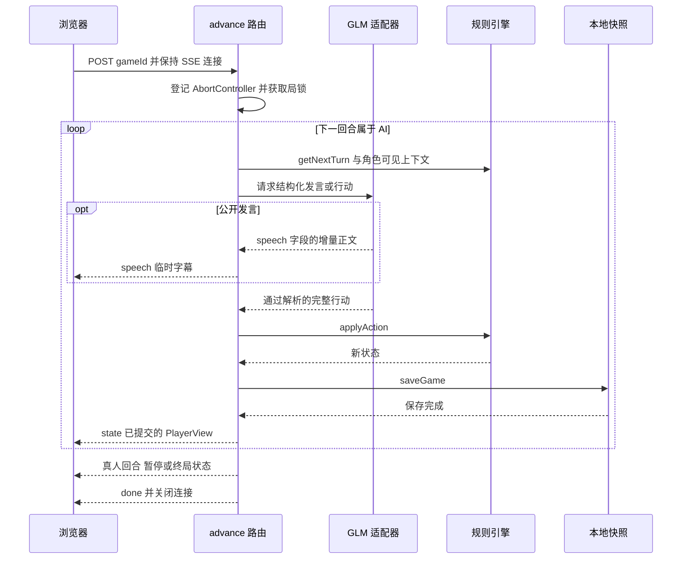

# 月下疑局架构设计

月下疑局 Moonlit Verdict 是面向本地个人使用的中文狼人杀游戏，由一名真人与八名 AI 共同完成九人对局。系统采用 Next.js 全栈应用、服务端规则引擎、GLM 文本模型，以及独立运行的本地配音和语音识别服务。规则引擎决定合法行动与胜负，模型负责各角色的表达与选择，浏览器接收经过权限过滤的对局视图。

本文面向开发、维护和评审人员，说明模块职责、状态流转、信息边界、数据恢复与运行约束。实现基线为 2026-10-25 的 `be29340`；后续架构变更应与对应源码一同更新。

## 1 设计目标与范围

| 目标 | 实现方式 |
| --- | --- |
| 规则可检查、可恢复 | 用显式状态机和结构化行动执行规则，将随机种子与完整状态一同保存 |
| 每个参与者仅获取允许的信息 | 服务端分别构造真人视图和各 AI 的角色上下文 |
| AI 发言自然且行动受约束 | 固定人物性格，要求模型返回 JSON，并再次通过规则引擎校验 |
| 长耗时调用期间保持反馈 | 用 SSE 推送公开发言的临时字幕和提交后的完整状态 |
| 语音操作可取消、可校对 | 配音按事件播放；录音转写进入草稿，由玩家确认后提交 |
| 便于单机安装和运行 | 一键启动脚本管理网页、TTS、STT 三个进程，数据和模型保存在本地 |

九人身份固定为三名狼人、三名村民、预言家、女巫和猎人。真人固定坐在 1 号位，可选择或随机获得身份，八名 AI 的姓名和性格固定。当前范围不包含警长、真人联机、账户登录、支付和云端托管。

## 2 总体架构与技术栈



浏览器只连接 Next.js 应用。Next.js 在服务端持有凭据、读取存档、调用 GLM 和语音服务；内置的两个 Python 语音服务只监听 `127.0.0.1`。默认情况下，语音推理在本机完成，AI 文本生成需要联网。

| 层次 | 技术与当前解析版本 | 作用 |
| --- | --- | --- |
| 页面与接口 | Next.js 16.4.3 App Router，Node.js 22+ | 同一应用提供页面、JSON API 和 SSE |
| 客户端 | React 19.3.1，TypeScript 5.9.3 | 对局界面与异步交互协调 |
| 样式与静态资源 | Tailwind CSS 4.3.3、项目 CSS、`public/` 素材 | 大厅、桌面环桌、移动布局和角色画面 |
| 文本模型 | 默认 `glm-5.3-flash` | 发言、目标选择、技能决策和终局复盘 |
| 本地语音 | Python 3.12+，sherpa-onnx 2.0.0，NumPy 2.5.4 | Kokoro v1.1-zh INT8 配音、SenseVoiceSmall INT8 转写 |
| 持久化 | Node.js 文件系统与 JSON | 对局快照和会话到对局的映射 |
| 工具链 | pnpm 11.25.0，tsx 与 Node.js 测试运行器，Python unittest | 安装、构建和验证 |

前端依赖版本取自 [pnpm-lock.yaml](../pnpm-lock.yaml)，Python 依赖分别固定在两个语音服务的 `requirements.txt` 中。

## 3 模块职责

| 模块 | 源码入口 | 职责 |
| --- | --- | --- |
| 应用入口 | [page.tsx](../src/app/page.tsx)、[layout.tsx](../src/app/layout.tsx) | 挂载客户端对局应用，设置全局样式和页面元信息 |
| 对局交互协调 | [GameApp.tsx](../src/components/GameApp.tsx) | 加载对局、提交行动、读取 SSE、暂停恢复、管理当前草稿与目标 |
| 历史与行动展示 | [GameHistory.tsx](../src/components/GameHistory.tsx)、[game-presentation.ts](../src/lib/ui/game-presentation.ts) | 筛选可见记录、汇总完整票型、解释目标资格和生成确认文案 |
| 浏览器语音 | [useSpeechAudio.ts](../src/hooks/useSpeechAudio.ts)、[useRecorder.ts](../src/hooks/useRecorder.ts)、[录音 Worklet](../public/wav-recorder.worklet.js) | 顺序播放、采集 PCM、编码 WAV、取消与重试 |
| 个人标记 | [usePlayerNotes.ts](../src/hooks/usePlayerNotes.ts) | 按对局保存怀疑、信任及身份声明标记 |
| 领域类型与规则 | [types.ts](../src/lib/game/types.ts)、[engine.ts](../src/lib/game/engine.ts) | 创建对局、生成回合、执行规则、结算胜负、过滤信息 |
| HTTP 应用层 | [API 路由](../src/app/api)、[http.ts](../src/lib/server/http.ts) | 会话绑定、同源和请求检查、版本校验、组织调用和响应 |
| 模型适配 | [model.ts](../src/lib/server/model.ts) | 构造角色提示词、调用模型、解析公开字幕和结构化行动 |
| 语音适配 | [speech.ts](../src/lib/server/speech.ts)、[local-tts.ts](../src/lib/server/local-tts.ts)、[stt-config.ts](../src/lib/server/stt-config.ts) | 文本分段、音频检查、服务调用、超时和提供方选择 |
| 存储与运行状态 | [store.ts](../src/lib/server/store.ts) | 原子文件替换、会话映射、局锁、推进取消、音频缓存 |
| 本地推理 | [TTS 服务](../services/local-tts/server.py)、[STT 服务](../services/local-stt/server.py) | 加载 ONNX 模型，提供受限 HTTP 推理接口 |
| 启动编排 | [start-local.mjs](../scripts/start-local.mjs) | 检查和安装依赖、探测服务、启动进程组、统一退出 |

规则模块只依赖领域类型，不读取 HTTP 请求、文件或模型接口。存储模块保存规则状态，不决定玩法。API 层承担这些模块之间的协调，使同一规则引擎能够直接用于回放测试。

客户端有三类状态：服务端返回的 `PlayerView`、尚未提交的草稿和目标，以及播放队列、弹窗、筛选和个人偏好。后两类只影响操作与展示。`localStorage` 保存配音开关、字号和 `moonlit-notes:<gameId>` 标记；个人标记不进入存档或 AI 上下文，也不被解释为真实身份。

## 4 核心数据与信息边界

### 4.1 领域数据

| 类型 | 主要内容 | 使用边界 |
| --- | --- | --- |
| `GameState` | 所有身份、存活状态、事件、行动队列、夜间行动、药品、票型、随机种子和版本 | 服务端内部与本地快照 |
| `Turn` | `id`、`kind`、`actorSeat`、合法 `choices`、是否可跳过和可用药品 | 引擎生成；真人仅获取自己的当前回合 |
| `GameAction` | 回合标识、行动者、行动类型、文本或目标、用药选择 | 输入规则引擎的命令 |
| `GameEvent` | 天数、类型、正文、作者、`visibility` 和可见席位 | 规则历史，出站前按身份过滤 |
| `VoteRound` | 完整投票轮次、逐票记录、候选人、平票与放逐结果 | 整轮结算后加入公开历史 |
| `PlayerView` | 真人身份与权限、可见玩家、可见事件、完整历史票型、当前可操作回合 | 浏览器取得的对局状态 |
| `StreamEvent` | `state`、`speech`、`error`、`done` 四类消息 | SSE 传输协议 |

`GameState.schemaVersion` 当前为 `1`。`revision` 在规则行动、暂停恢复和复盘保存等状态变更时递增，用于拒绝基于旧状态的操作。`processedActions` 同时记录引擎已处理的回合标识及 HTTP 真人操作的 `actionId`；HTTP 层据此识别重复请求。

### 4.2 真人与 AI 的信息投影

`toPlayerView(state)` 为固定的 1 号真人生成视图，`getAgentContext(state, seat)` 为指定 AI 生成上下文。二者在服务端过滤事件，前端隐藏控件不承担信息隔离职责。

| 数据 | 进行中的可见性 |
| --- | --- |
| 玩家姓名、人物性格、席位和存活情况 | 公开 |
| 真实身份 | 自己可见；狼人额外知道所有狼队友 |
| 公开发言与已结算票型 | 所有参与者可见，死者的历史发言仍保留 |
| 狼队私聊、袭击提议与最终刀人目标 | 仅狼人可见 |
| 查验、用药记录 | 仅对应行动者可见 |
| 女巫的狼刀目标 | 由其当前回合提供；解药耗尽后不再提供 |
| 正在提交的单张放逐票 | 留在服务端，整轮结束后才公开 |
| 他人的夜间当前行动 | 不向真人暴露；真人视图只返回自己的 `turn`，夜间不显示当前行动席位 |

终局向真人公开全部身份，其他角色的私密事件仍按原权限过滤。复盘使用胜负、终局身份、票型和公开事件，不接收整份私密行动历史。公开发言里的身份与查验声明是玩家陈述，可以撒谎；系统不会据此改写真实身份。

### 4.3 会话与凭据

`moonlit_session` 是随机会话标识 Cookie，设置 `HttpOnly`、`SameSite=Strict`、根路径和一年有效期；通过 HTTPS 创建时设置 `Secure`。服务端通过会话文件查找当前对局，再核对请求携带的 `gameId`，不允许仅凭他人的对局 ID 访问。

写接口检查 `Origin` 与实际 HTTP `Host`、协议是否一致，拒绝携带不匹配来源的请求；未携带 `Origin` 的请求允许继续，因此该检查配合本机监听和 Cookie 使用，不能替代账户鉴权。接口对请求体、标识和合法目标分别做检查。普通 JSON 请求检查 `Content-Length` 和读取后的字符串长度，上限值均为 `16384`；语音上传另有实际字节流量和文件大小限制。

模型凭据保存在服务端环境中，不使用 `NEXT_PUBLIC_` 变量，不进入 `PlayerView` 或游戏存档。配置查询只返回模型名、STT 提供方和 Key 是否已配置；`configured=true` 表示发现有效形式的配置，不保证上游鉴权、额度或模型服务可用。上游鉴权和错误响应经过转换，避免向浏览器返回原始响应体或凭据。

本地快照包含全部身份和私密行动，依赖本机文件权限保护。模型调用会把当前 AI 有权看到的资料发送给所配置的文本服务；选择外部 STT 后会向该提供方上传录音。

## 5 对局状态机

`phase` 表示夜晚、白天或终局；`stage` 表示细分步骤；`queue` 保存该步骤尚未执行的回合。`getNextTurn` 根据当前状态重新计算合法目标，避免直接使用过期候选列表。没有参与者的步骤由 `advanceEmptyStages` 自动跳过。



`applyAction` 先核对暂停和终局状态、回合 ID、行动者、行动类型与行动资格，再克隆原状态执行变更。成功后移除队首回合、递增版本并推进空步骤。服务端校验是最终依据，浏览器的目标提示只用于减少误操作。

主要规则约束如下：

- 狼人不能袭击自己或队友，狼队平票通过已保存的随机种子决胜。
- 女巫每晚最多使用一瓶药，仅首夜可以自救；毒药不能被解药抵消，狼刀与毒药命中同一人时按毒杀处理。
- 预言家不能查验自己，只得到狼人或好人阵营结果。
- 放逐允许弃票，禁止自投；首次最高票平票进入一次 PK，候选人不参与复投，再次平票则无人放逐。
- 首夜遇害者和白天被放逐者有遗言；猎人被毒死不能开枪，其他允许的死亡可开枪或放弃。中断队列执行完后再判胜。
- 全部狼人出局则好人胜；全部村民或全部神职出局则狼人胜；双方同时满足则平局。真人出局后继续观战。

发牌、发言起点和狼队平票使用状态中的伪随机种子。对同一保存状态执行同一行动，会得到相同的规则结果；创建时间、更新时间及重新调用外部模型的输出不属于这一确定性保证。

## 6 请求与推进时序

### 6.1 真人行动



HTTP 层把真人行动者固定为 1 号位。`actionId` 用于识别同一请求的重试，`revision` 防止旧页面覆盖新状态，`turnId` 防止操作落入另一回合。重复 `actionId` 在版本校验之前返回当前视图；未识别的旧版本操作返回 `409`。

### 6.2 AI 推进与提交边界



每局同一时间只登记一个推进任务，整个循环持有该局的进程内锁。单次请求最多执行 120 次循环，随后关闭；浏览器可依据新状态再次发起推进。终局缺少复盘时，推进接口会生成并保存复盘。

公开字幕是临时预览，最终 JSON 校验、规则执行和存盘完成后，`state` 才代表已提交事实。狼人私聊不发送增量公开字幕，只通过符合权限的完整视图返回。`speech` 不进入存档，也不直接进入配音队列。

暂停请求先取消当前推进，再等待局锁并保存暂停状态。为避免 AI 刚完成一步导致暂停失效，`pause` 特意跳过 `revision` 检查；`resume` 仍检查版本。浏览器同时取消旧 SSE、播放和录音，并用流程版本号忽略迟到的消息。

正常的模型或解析失败会保留尚未完成的回合，将未终局对局保存为暂停状态，并发送状态和错误。连接中断或取消时，正在生成且尚未提交的行动可以放弃；已开始的文件写入仍可能完成。重新读取 `/api/game` 后，以磁盘上最新成功保存的状态继续。

## 7 HTTP 与流接口

| 接口 | 主要输入 | 成功结果与行为 |
| --- | --- | --- |
| `GET /api/game` | 会话 Cookie | `{ game, configured, models }`；无有效对局时 `game=null`，响应不缓存 |
| `POST /api/game` | 可选 `preferredRole`、`name` | 创建新局，保存快照和会话映射，返回 `{ game }` 并设置 Cookie |
| `POST /api/game/actions` | `gameId`、`revision`、`actionId`，普通行动另含 `turnId`、`kind` 及内容 | 返回 `{ game }`；控制操作使用 `control=pause/resume` |
| `POST /api/game/advance` | `gameId` | `text/event-stream`，顺序推进 AI 至下一真人回合、暂停、终局或本次循环上限 |
| `POST /api/tts` | `gameId`、`eventId`、可选 `chunkIndex` | 返回 WAV，`X-Audio-Chunks` 表示总段数 |
| `POST /api/stt` | multipart 中的 `file`，可附 `gameId`、`turnId` | 返回 `{ text }`，不修改对局，响应为 `private, no-store` |

行动内容根据回合使用 `text`、`targetSeat` 或 `use=save/poison/pass`。昵称在 API 层限制为 16 字符；玩家发言界面限制为 1200 字符，规则引擎接受的文本上限为 1600 字符，AI 发言解析上限为 700 字符。这些限制处于不同层，增加输入方式时需分别核对。

SSE 通过 `fetch` 发起 POST，再读取 `ReadableStream`，没有使用浏览器原生 `EventSource`。每条消息格式为 `data: <JSON>` 加空行：

| 消息类型 | 字段 | 客户端处理 |
| --- | --- | --- |
| `state` | `game` | 替换当前视图并清理临时字幕 |
| `speech` | `turnId`、`seat`、`text` | 更新该发言者的临时字幕 |
| `error` | `message` | 展示错误并清理临时字幕 |
| `done` | 无额外字段 | 表示本次推进结束，不表示整局必然结束 |

流建立前的请求错误使用 HTTP 状态和 `{ error }`。进入流后，AI 执行错误通过 `error` 消息传递。常见状态包括输入错误 `400`、会话缺失 `401`、来源不匹配 `403`、对局不存在 `404`、版本或会话冲突 `409`、过大请求 `413`、语音适配错误 `502`，以及文本模型未配置 `503`。

## 8 AI 行为生成

模型调用没有独立的 Agent 框架或向量记忆库。每轮从当前 `GameState` 构造本角色的可见上下文，包含规则、人物性格、存活玩家、可见事件、历史票型和当前合法行动。

1. `decideTurn` 根据回合类型选择提示词。发言要求唯一的 `speech` 字段，技能和投票要求受限的目标或用药字段。
2. `completion` 调用兼容聊天补全的 `chat/completions`，请求 JSON 对象。公开发言使用流式响应，狼人私聊与目标决策使用完整响应。
3. 流解析只读取 `delta.content`。`partialSpeech` 仅接受对象开头明确的 `speech` 字符串，`reasoning_content` 不发送到界面或配音。
4. `parseSpeech` 和 `parseDecision` 检查字段、长度、可用药品和目标；之后 `applyAction` 再检查真实回合与游戏规则。
5. 一轮决策最多尝试两次。余额不足、鉴权失败等不可重试错误直接停止；没有伪造发言或随机行动来替代失败的模型输出。

单次文本 HTTP 调用默认 60 秒超时，并与推进取消信号组合。模型的思考配置按模型名选择；内部思考可以由提供方执行，但应用只使用约定的最终内容字段。公开字幕可能来自之后校验失败的尝试，因此不能作为已提交事件使用。

终局复盘再次调用模型，输入已结算胜负、全部身份、历史票型和公开事件。提示词要求区分终局已揭晓身份和当时玩家可知的线索。复盘失败可重试生成，不回滚已经完成的胜负结算。

## 9 语音交互

### 9.1 配音链路

`已提交可见事件 → /api/tts → 文本分段与缓存 → 本地 TTS → WAV → 浏览器顺序播放`

`/api/tts` 接收事件 ID，服务端重新取得真人视图，确认该事件属于当前局且可见、类型为 `speech`、`wolf_chat` 或 `review`，然后从事件正文取文本。客户端不能通过该接口提交任意配音正文。

文本按最多 300 字符分段，席位决定固定音色，复盘使用旁白音色。客户端依次请求所有段落；音频缓存在进程内，按写入先后淘汰，最多 24 段或 32 MiB，不保存到对局快照。每段上游音频最多 12 MiB，并检查 WAV 标识及完整长度。

内置 Kokoro 服务每次只执行一个推理任务。适配器遇到 `429/503` 时依次等待 0.5 秒、1 秒、之后每次 2 秒，等待和合成共用 120 秒期限。取消 HTTP 等待或播放后，已开始的原生推理可能继续完成。

客户端自动播放新提交的 AI 公开发言，恢复一局时把已有事件标为已见，避免重放整段历史。配音队列与规则推进独立，AI 可以在上一条音频仍播放时继续行动。界面依据正在播放的事件显示姓名和高亮，避免错配当前行动者。配音失败只影响播放，可关闭配音或手动重播后继续文字对局。

### 9.2 录音与转写链路

`getUserMedia → AudioWorklet → 单声道 16 位 PCM WAV → /api/stt → 转写服务 → 可编辑草稿 → 玩家确认提交`

浏览器请求 16 kHz 音频上下文，按实际采样率写入 WAV。录音在约 29.5 秒时触发停止，并以采样帧数限制最长 30 秒；取消时停止麦克风轨道、关闭音频上下文、释放样本和待重试录音。开始录音会先停止 AI 配音。

上传接口按实际读取字节限制整个表单到 26 MiB，并限制 WAV 文件到 25 MiB。音频结构与时长在调用识别前检查；本地服务进一步要求 16 位 PCM、8–192 kHz、1–2 声道、约 0.2–30 秒录音。转写返回体限制为 64 KiB，文本限制为 3000 字符，防止异常服务返回无界内容。

浏览器正常录音会绑定 `gameId` 和 `turnId`。服务端在识别前后核对对局和回合，客户端另用录音版本号丢弃过期结果。接口允许省略回合字段；回合绑定检查只在提供 `turnId` 时执行，其他调用方应沿用浏览器的绑定方式。

转写成功后完整追加到当前草稿，不自动截断或提交。临时网络或服务失败会在浏览器内存保留同一 WAV，供玩家点击重试；成功、取消、开始新录音或切换回合后释放。草稿超出界面上限时提示编辑，并禁止提交。

### 9.3 识别提供方

| `STT_PROVIDER` | 路径 | 凭据与约束 |
| --- | --- | --- |
| `local`，默认 | `STT_BASE_URL` 下的 `audio/transcriptions` | 默认 SenseVoice；仅接受本机地址，不需要 STT Key |
| `zhipu` | `ZHIPU_BASE_URL` 下的 `audio/transcriptions` | 默认 `glm-asr-2512`，使用智谱 Key 和对应 multipart 协议 |
| `external` | `STT_BASE_URL` 下的 `audio/transcriptions` | 必须配置模型和服务地址，可使用独立 `STT_API_KEY` |

提供方失败时不会自动切换到另一服务。内置 SenseVoice 不使用动态术语 prompt，识别结果仍需玩家校对。正常录音请求只在内存处理，不写入音频文件、游戏存档或语音服务请求日志；确认后的文字才作为发言进入历史。显式运行 probe 等验收脚本会另外保存报告和样本。

## 10 存储与故障恢复

### 10.1 文件布局

```text
.data/
  games/<gameId>.json          完整 GameState 快照
  sessions/<sessionId>.json    当前 gameId 映射
  tts/                        TTS 模型和 Python 虚拟环境
  stt/                        STT 模型和 Python 虚拟环境
  launcher/                   依赖安装指纹
  audit/                      显式验收脚本的报告与音频
```

`MOONLIT_DATA_DIR` 可替换游戏与会话文件的根目录；语音模型和启动标记仍由各脚本按项目 `.data/` 路径管理。新局会改变当前会话映射，旧局文件仍保留，没有自动清理策略。

`atomicJSON` 在目标目录创建文件夹，以随机临时文件写完整 JSON，再通过 `rename` 替换目标文件，最后清理临时文件。创建目录使用 `0700`，文件使用 `0600`。单文件替换可避免读到半写 JSON；游戏文件与会话文件分别保存，不构成跨文件事务，也没有 `fsync` 断电持久化保证。

事件列表是快照中的历史字段，系统没有单独的追加事件日志，也不能只靠事件重建全部状态。`readGame` 检查 schema、ID 及必要数组；当前没有完整的 schema 校验、版本迁移、备份回退或损坏自动修复，读取失败会提示保留数据后处理。

### 10.2 并发控制

| 机制 | 作用域 | 作用 |
| --- | --- | --- |
| `withLock(session:<id>)` | 单个 Node.js 进程 | 串行化同一会话的新局创建 |
| `withLock(gameId)` | 单个 Node.js 进程 | 串行化真人行动、控制操作及 AI 推进 |
| `runtimeState.active` | 单个 Node.js 进程 | 拒绝同一局重复推进，并保存取消控制器 |
| `revision` 与 `turnId` | 已保存的对局 | 拒绝过期状态和错误回合操作 |
| `actionId` | 当前对局的已处理列表 | 重复请求返回当前状态，避免再次执行 |
| Python 单槽信号量 | 各自语音服务进程 | 限制同一模型并行推理；忙碌时返回 `503` |

Node.js 的锁、取消控制器与音频缓存挂在 `globalThis` 上，可在同一运行环境中复用，进程退出后清空。JSON 文件支持多个会话保留各自对局，但这些进程内机制要求由一个共享运行状态的 Node.js 应用进程管理写入，不能直接扩展成多实例或无状态部署。

### 10.3 故障后的行为

| 情况 | 恢复方式 |
| --- | --- |
| 刷新页面或重启 Node.js | 用原 Cookie 找到会话和最新成功保存的快照，恢复行动队列、随机种子和暂停状态 |
| 模型输出中断或校验失败 | 不提交该行动；通常保存暂停状态，由玩家重试当前回合 |
| 已存盘后客户端未收到响应 | 重新 GET 当前状态；使用相同 `actionId` 的真人请求可识别为已处理 |
| 临时字幕显示后请求取消 | 清理字幕，恢复时以快照为准，尚未保存的模型行动可能重新生成 |
| TTS 或 STT 不可用 | 配音停止或录音可重试，玩家仍可用文字完成对局 |
| 会话 Cookie 丢失 | 浏览器无法自动定位旧局；当前没有账户检索或恢复入口 |

恢复保存状态不意味着再次生成完全相同的 AI 文本，也不意味着跨文件事务、自动故障转移或断电零丢失。

## 11 运行配置与部署

默认拓扑是同一台机器上的一个 Next.js 进程和两个 Python 进程：网页端口 `3000`，TTS 端口 `8880`，STT 端口 `8881`。Next.js API 明确使用 Node.js runtime，依赖文件系统与长连接；Edge runtime、只读文件系统和多实例部署需要另行设计。

| 配置 | 默认值或要求 | 架构作用 |
| --- | --- | --- |
| `ZHIPU_API_KEY` | AI 文本对局必需 | 服务端认证，缺失时可浏览页面但无法推进 AI |
| `ZHIPU_BASE_URL`、`ZHIPU_CHAT_MODEL` | 智谱标准接口、`glm-5.3-flash` | 文本提供方和模型 |
| `TTS_BASE_URL`、`TTS_MODEL` | `http://127.0.0.1:8880/v1`、`kokoro-v1.1-zh` | Next.js 连接的配音服务 |
| `STT_PROVIDER`、`STT_BASE_URL`、`STT_MODEL` | `local`、`http://127.0.0.1:8881/v1`、`sensevoice-small-int8` | 选择识别服务和数据发送位置 |
| `STT_API_KEY`、`ZHIPU_STT_MODEL` | 按显式选择的提供方设置 | 外部识别专用认证或智谱识别模型 |
| `MOONLIT_DATA_DIR` | 项目根目录的 `.data` | 游戏与会话快照存储位置 |
| `PORT`、`PYTHON_BIN` | `3000`、可用 Python 3.12+ | 一键启动使用的网页端口与安装解释器 |

`start.command` 和 `start.sh` 最终执行启动编排脚本，流程如下：

1. 检查 Node.js 版本，按锁文件安装依赖；本机 pnpm 不匹配时使用 npm 临时运行项目固定版本。
2. 按 Next.js 开发模式规则加载环境文件，已有进程环境优先；缺少 Key 时可隐藏输入，只注入当前进程。
3. 检查端口，探测语音服务 `/health` 并匹配模型；健康服务直接复用，缺失的内置运行时和模型安装后启动。模型归档以固定 SHA-256 校验。
4. 依次等待语音服务和网页就绪，再打开浏览器。显式选择外部 STT 时跳过本地 STT 安装与启动。
5. 退出或子服务意外终止时，清理本次启动的进程组；复用的服务由原启动者继续管理。

自动编排面向 macOS、Linux 和 WSL，启动的是 `next dev --webpack`。生产模式需先构建，再分别启动语音服务和 `pnpm start`；`pnpm start` 只启动 Next.js。自定义远程 TTS、HTTPS、IPv6 或非 `/v1` 服务路径由使用者自行管理，启动脚本不代为启动对应服务。

详细安装与参数见 [README](../README.md)、[本地 TTS](LOCAL_TTS.md) 和 [本地 STT](LOCAL_STT.md)。

## 12 设计取舍与演进方向

| 当前选择 | 收益 | 当前约束 |
| --- | --- | --- |
| 显式回合队列和服务端结算 | 行动易于检查，规则可直接回放 | 新身份需要同时扩展类型、阶段、信息过滤与测试 |
| 每次模型调用重新构造可见上下文 | 信息来源明确，没有额外记忆存储 | 历史随对局增长，目前没有摘要或上下文预算管理 |
| 完整 JSON 快照和进程内锁 | 安装简单，适合本地个人使用 | 每次写全量历史，没有跨进程协调和数据库事务 |
| POST SSE 顺序推进 | 一条连接提供字幕与已提交状态 | 需维持长连接，没有断线消息补发日志，恢复靠重新读取快照 |
| 独立 CPU 语音进程 | 语音无需云端 Key，可与文本服务分开维护 | 推理受本机 CPU 和单槽并发限制，取消请求不保证立即终止推理 |
| 配音与对局推进独立 | 关闭或等待配音不阻塞文字玩法 | 播放进度可能落后于对局进度 |

后续扩展应按目标处理相应边界：

- 增加身份或规则时，先扩展 `GameState`、回合、投影和确定性回放，再接入模型提示与 UI。
- 支持多人或云端时，引入账户和房间权限、事务存储、跨实例互斥、任务所有权和持久取消机制，替换当前本机会话假设。
- 支持长期运行时，加入存档迁移、损坏检测与备份、旧局清理，并为可见历史建立有界上下文策略。
- 改进语音体验时，围绕真实设备和代表性发言测量延迟，再决定播放同步、预取和缓存策略。

这些是扩展路径，当前版本未实现对应的多人、分布式或运维能力。

## 13 验证与维护

验证按模块契约组织，避免把模拟测试、真实模型探测和浏览器实测混为一类。

| 范围 | 验证入口 | 主要检查内容 |
| --- | --- | --- |
| 规则与恢复 | [engine.test.ts](../src/lib/game/engine.test.ts) | 身份与事件隔离、规则边界、JSON 恢复；包含 50 个种子乘五种真人身份的 250 局回放 |
| HTTP 与存储 | `src/lib/server/*.test.ts` | 会话与来源、幂等、过期拒绝、取消、原子快照和音频边界 |
| 展示逻辑 | [game-presentation.test.ts](../src/lib/ui/game-presentation.test.ts) | 历史筛选、完整票型、个人标记、目标与用药确认 |
| 启动编排 | [start-local.test.mjs](../scripts/start-local.test.mjs) | 冷暖启动、服务复用、端口冲突和所属进程清理 |
| Python HTTP 服务 | [TTS 测试](../services/local-tts/test_server.py)、[STT 测试](../services/local-stt/test_server.py) | 协议、输入限制和单槽推理，使用替身推理输出 |
| 真实服务探测 | `pnpm tts:probe`、`pnpm stt:probe`、`pnpm audit:live` | 实际音频合成、转写或文本整局，分别需要对应服务和配置 |
| 浏览器交互 | [现有验收记录](VERIFICATION.md)、[交互验收](GAMEPLAY_UX_VERIFICATION.md) | 目标提交、暂停恢复、阅读、播放、录音草稿和桌面移动布局 |

应用代码变更使用 `pnpm typecheck`、`pnpm test` 和 `pnpm build`；Python 服务变更另运行 `pnpm tts:test` 或 `pnpm stt:test`。改变交互流程时补充实际浏览器操作。纯文档变更检查内容、路径引用和 `git diff --check`。

历史真实模型与语音验收的条件及限制保留在各验收记录中。转写准确率、物理麦克风表现、外部 STT 可用性及机器性能不能由协议测试推出。维护接口或存档时，应同步更新本文、相关部署说明与实际完成的验证记录。
